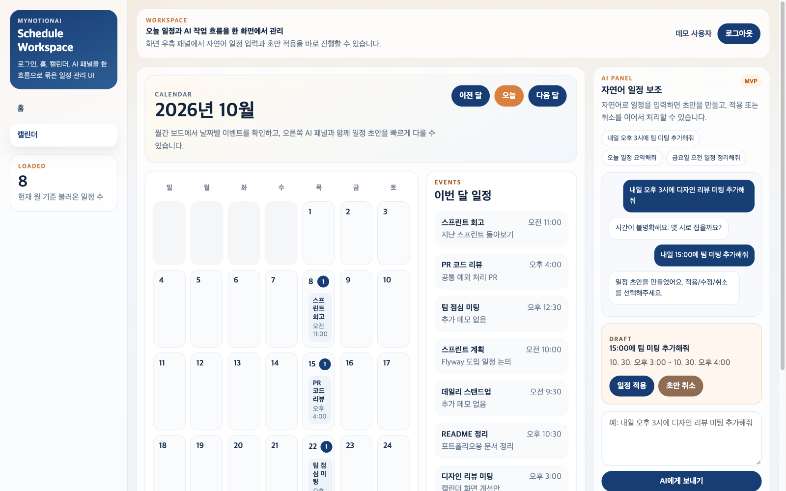
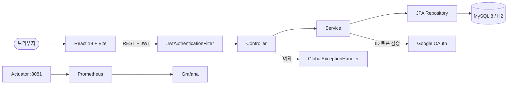

# MyNotionAI

> "내일 15시에 팀 미팅 추가해줘"처럼 **자연어로 일정 초안**을 만들고 캘린더에서 관리하는 서비스

       

<sub>개인 프로젝트 · 2026.02 ~ 고도화 중</sub>



<br/>

## 핵심 성과

| 지표 | 결과 |
|---|---|
| 자동화 테스트 | **56건 통과** (Controller · Service · Repository · JWT · Flyway) |
| 응답 시간 기준선 | 20 VU 부하에서 p95 **약 11ms**, 에러율 **0%** (k6) |
| 버그 수정 | 월별 조회 경계 버그를 반개구간 쿼리로 고치고 경계 4개를 테스트로 고정 |
| 운영 스택 | 앱 · MySQL · Prometheus · Grafana를 Docker Compose 한 번에 실행 |

<br/>

## 주요 기능

- **인증** — 이메일 회원가입·로그인, JWT Stateless 인증, Google ID 토큰 로그인
- **일정** — 월별 조회, 등록·수정·삭제, 사용자 간 데이터 격리
- **자연어 일정 초안** — 문장에서 날짜·시간을 규칙 기반으로 해석해 초안 생성 → 적용·수정·취소 (LLM 연동은 예정)
- **리마인더** — 1분 주기 스케줄러가 1시간 뒤 일정을 찾아 알림 기록

<br/>

## 아키텍처



<br/>

## 기술 스택

| 영역 | 사용 기술 |
|---|---|
| Backend | Java 17, Spring Boot 3.2, Spring Security, Spring Data JPA, JJWT |
| Database | MySQL 8, H2 (로컬·테스트), Flyway |
| Frontend | React 19, Vite 7, TanStack Query, Zustand |
| Test | JUnit 5, Mockito, `@WebMvcTest`, `@DataJpaTest`, k6 |
| Infra | Docker Compose, Actuator + Micrometer, Prometheus, Grafana |

<br/>

## 기술적 의사결정

### 1. `BETWEEN`이 양 끝을 포함한다 → 반개구간 쿼리

- **문제**: 9월을 조회하면 10월 1일 0시 일정이 함께 나왔습니다.
- **해결**: `findBy...Between` 대신 JPQL `startAt >= :from and startAt < :to`로 바꿨습니다.
- **결과**: 실제 H2 쿼리로 경계 4개(시작 직전·정각, 끝 직전·정각)를 테스트합니다.

### 2. H2 테스트는 통과했는데 MySQL에서 시작 실패 → Flyway + 실제 MySQL 검증

- **문제**: `ddl-auto: update`를 Flyway로 바꾸자, 빈 MySQL에서 enum 컬럼 타입 불일치로 앱이 뜨지 않았습니다.
- **해결**: `@JdbcTypeCode(SqlTypes.VARCHAR)`로 매핑을 명시하고, 일회용 `mysql:8.0` 컨테이너로 실패 재현 → 수정 후 정상 기동을 확인했습니다.
- **배운 점**: H2의 MySQL 모드는 MySQL이 아닙니다.

### 3. "빨라졌다"를 숫자로 말할 수 없다 → 관측성 기준선

- **문제**: 응답 시간·에러율·커넥션 풀을 볼 방법이 없었습니다.
- **해결**: Actuator 지표를 관리 포트 8081로 분리해 노출하고, Prometheus·Grafana 대시보드(6개 패널)와 k6 시나리오를 구성했습니다.
- **결과**: 개선 전 기준선 p95 약 11ms, 에러율 0%를 기록했습니다. 같은 Mac에서 잰 저부하 수치라 상대 비교용입니다.

<br/>

## 개발 방식

고도화 단계는 **AI 에이전트와 역할을 나눠** 진행합니다. 저는 방향 결정과 작업 지시서·머지 승인을 맡고, 구현·리뷰(Codex)와 PM 업무(Claude)는 에이전트가 맡습니다. 규칙은 [`AGENTS.md`](AGENTS.md), 작업 기록은 [`docs/tasks`](docs/tasks)에 있습니다.

<br/>

## 실행 방법

```bash
# 백엔드 (local 프로필, 환경 변수 불필요) — JDK 17
cd backend && ./mvnw spring-boot:run          # http://localhost:8080/api
./mvnw test                                    # 테스트 56건

# 프론트엔드
cd frontend && cp .env.example .env && npm install && npm run dev   # http://localhost:5173

# 운영 스택 (앱 · MySQL · Prometheus · Grafana)
cp .env.example .env && docker compose up -d --build
```

<br/>

## 더 보기

| 문서 | 내용 |
|---|---|
| [상세 문서](docs/details.md) | ERD, API 목록, 테스트 구성, 알려진 문제와 로드맵, 트러블슈팅 |
| [성능 기준선](docs/performance/20261117-baseline.md) | k6 시나리오와 측정값, PromQL |
| [작업 기록](docs/tasks) · [코드 리뷰](docs/reviews) | 문제 → 원인 → 해결 → 결과 |
