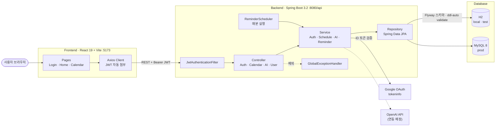
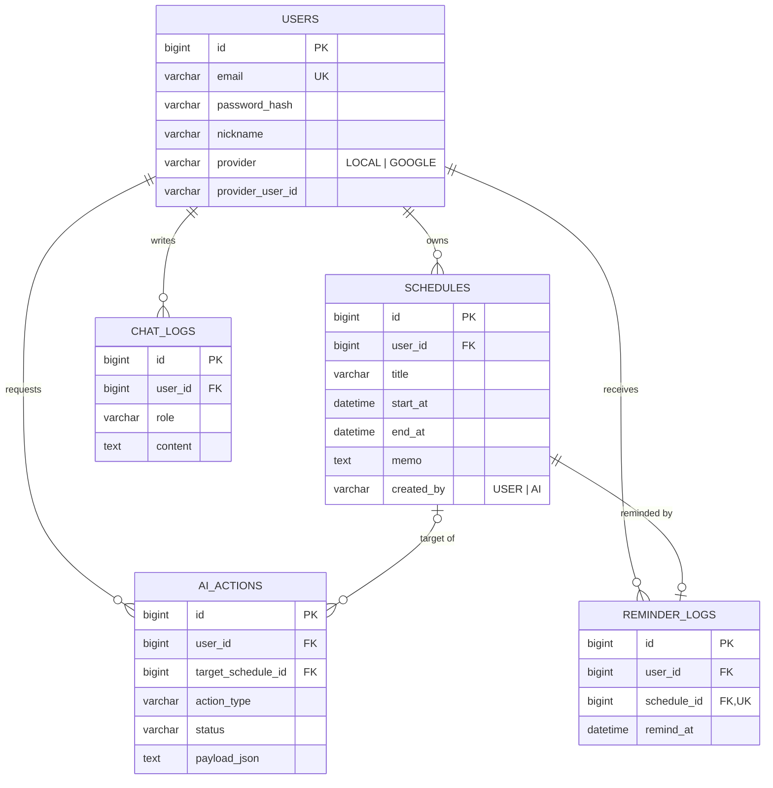

# MyNotionAI

> 자연어로 일정을 등록하고 관리하는 **AI 일정 관리 서비스**
> Spring Boot 백엔드와 React 프론트엔드를 하나의 저장소에서 관리하는 모노레포입니다.


## 목차

1. [프로젝트 소개](#프로젝트-소개)
2. [주요 기능](#주요-기능)
3. [기술 스택](#기술-스택)
4. [시스템 아키텍처](#시스템-아키텍처)
5. [ERD](#erd)
6. [API](#api)
7. [기술적 고민과 해결](#기술적-고민과-해결)
8. [테스트](#테스트)
9. [협업 방식](#협업-방식)
10. [현재 한계와 개선 로드맵](#현재-한계와-개선-로드맵)
11. [실행 방법](#실행-방법)

## 프로젝트 소개

캘린더에서 일정을 직접 관리하거나, **"내일 15:00에 팀 미팅 추가해줘"**처럼 자연어로 요청해 일정 초안을 받아 적용할 수 있는 서비스입니다.

동작하는 MVP를 먼저 완성한 뒤, **실무 백엔드 주제(예외 설계, 테스트, DB 마이그레이션, 외부 API 연동, 운영)를 단계적으로 적용하는 것**을 목표로 고도화하고 있습니다.

| 로그인 | 캘린더 | AI 패널 |
|---|---|---|
|  |  |  |

<sub>※ 화면 설계 단계의 와이어프레임입니다.</sub>

## 주요 기능

| 분류 | 기능 |
|---|---|
| 인증 | 이메일 회원가입·로그인, JWT 기반 Stateless 인증, Google ID 토큰 로그인 |
| 일정 | 월별 조회, 등록·수정·삭제, 사용자별 데이터 격리 |
| AI 일정 보조 | 자연어 → 일정 초안 생성, 초안 적용·수정·취소, 오늘 일정 요약, 대화 로그 |
| 리마인더 | 1분 주기 스케줄러가 1시간 뒤 시작하는 일정을 찾아 알림 기록 |

## 기술 스택

| 영역 | 기술 |
|---|---|
| Backend | Java 17, Spring Boot 3.2, Spring Security, Spring Data JPA (Hibernate 6.3), JJWT 0.12 |
| Database | MySQL 8 (운영), H2 (로컬·테스트), Flyway 마이그레이션 |
| Frontend | React 19, Vite 7, React Router 7, TanStack Query, Zustand, Axios |
| Test | JUnit 5, Mockito, `@WebMvcTest`, `@DataJpaTest`, spring-security-test |
| Tool | Maven, npm, Docker (검증용 MySQL), GitHub |

## 시스템 아키텍처



### 백엔드 패키지 구조

```
backend/src/main/java/com/mynotionai/
├── controller/   REST API (Auth, Calendar, AI, User)
├── service/      비즈니스 로직 (Auth, Schedule, AI, GoogleTokenVerifier, Reminder)
├── repository/   Spring Data JPA
├── entity/       User, Schedule, ChatLog, AiAction, ReminderLog
├── dto/          요청·응답 DTO
├── exception/    ErrorCode, BusinessException, ApiErrorResponse, GlobalExceptionHandler
├── config/       SecurityConfig (CORS, Stateless, /auth/** 공개)
└── security/     JwtTokenProvider, JwtAuthenticationFilter
```

### 실행 프로필

| 프로필 | DB | 용도 |
|---|---|---|
| `local` (기본값) | H2 파일 (`backend/data/`) | 로컬 개발, 환경 변수 없이 실행 |
| `prod` | MySQL 8 | 운영, `DB_USERNAME`·`DB_PASSWORD`·`JWT_SECRET` 없으면 시작 실패 |
| `test` | H2 인메모리 (`MODE=MySQL`) | `mvn test` 전용 |

## ERD



## API

Base URL: `http://localhost:8080/api` · `/auth/**` 외에는 `Authorization: Bearer <JWT>` 필요

| 분류 | Method | Path | 설명 |
|---|---|---|---|
| 인증 | POST | `/auth/register` | 회원가입 |
| | POST | `/auth/login` | 이메일 로그인 |
| | POST | `/auth/google` | Google ID 토큰 로그인 |
| 일정 | GET | `/calendar/events?year=&month=` | 월별 조회 |
| | POST | `/calendar/events` | 등록 |
| | PUT | `/calendar/events/{id}` | 수정 |
| | DELETE | `/calendar/events/{id}` | 삭제 |
| AI | POST | `/ai/analyze` | 자연어 → 일정 초안 |
| | POST | `/ai/apply` · `/ai/revise` · `/ai/cancel` | 초안 적용 · 수정 · 취소 |
| | GET | `/ai/today-summary` | 오늘 일정 요약 |
| | GET | `/ai/chat-logs?limit=` | AI 대화 로그 |
| 사용자 | GET · PUT | `/user/profile` | 프로필 조회 · 수정 |

에러 응답은 공통 형식으로 통일되어 있습니다.

```json
{
  "code": "INVALID_INPUT",
  "message": "Invalid input",
  "timestamp": "2026-10-29T15:00:00",
  "fieldErrors": { "title": "제목은 필수입니다" }
}
```

`fieldErrors`는 입력값 검증 실패 시에만 포함됩니다. 예: 없는 일정 조회 → `404 SCHEDULE_NOT_FOUND`

## 기술적 고민과 해결

각 작업은 `문제 → 원인 → 해결 → 결과` 순서로 기록했습니다. 상세 내용은 [`docs/tasks`](docs/tasks)와 [`docs/reviews`](docs/reviews)에 있습니다.

### 1. 공통 예외 처리와 내부 정보 노출 차단

- **문제**: 서비스마다 `ResponseStatusException`을 직접 던져 에러 응답 형식이 제각각이었고, 잘못된 JSON 요청 시 Jackson 파싱 상세(Java 타입명)가, 500 에러 시 서버 설정 메시지가 그대로 응답에 노출되었습니다.
- **원인**: 예외 메시지(`ex.getMessage()`)를 클라이언트 응답에 그대로 사용했습니다.
- **해결**: `ErrorCode` enum + `BusinessException` + `ResponseEntityExceptionHandler`를 상속한 `GlobalExceptionHandler`로 응답 형식을 통일했습니다. 5xx는 일반 메시지로 바꾸고 상세는 로그로만 남기며, 표준에 없는 상태 코드도 안전하게 처리합니다.
- **결과**: 404·400·405·500 등 11개 Controller 테스트로 "내부 정보가 응답에 없음"을 검증합니다.

### 2. 월별 조회 경계 버그 (`BETWEEN`의 함정)

- **문제**: 9월 일정을 조회하면 **10월 1일 0시** 일정이 함께 나오고, 오늘 요약에 **내일 0시** 일정이 포함되었습니다.
- **원인**: Spring Data JPA의 `findBy...Between`은 SQL `BETWEEN`으로 바뀌어 **양 끝을 모두 포함**합니다.
- **해결**: JPQL로 반개구간 `[from, to)` (`startAt >= :from and startAt < :to`) 조회 메서드를 만들고, 잘못된 메서드는 삭제했습니다.
- **결과**: 실제 H2 쿼리로 "시작 직전·시작 정각·끝 직전·끝 정각" 4개 경계를 검증하는 리포지토리 테스트를 추가했습니다.

### 3. `ddl-auto: update`에서 Flyway로

- **문제**: Hibernate가 스키마를 기록 없이 바꾸고, 운영에서 `JWT_SECRET`이 빠져도 개발용 기본값으로 앱이 시작되었습니다.
- **해결**: `local`·`prod`·`test` 프로필을 분리하고, 스키마를 `V1__init_schema.sql`로 관리하도록 바꿨습니다. Hibernate는 `validate`로 엔티티와 테이블이 일치하는지만 검사합니다. 기존 운영 DB는 `baseline-on-migrate`로 V1 상태로 인정합니다.
- **도입 중 발견한 문제 두 가지**
  - **H2 인덱스 이름 충돌**: 두 테이블이 같은 인덱스 이름 `idx_user_created`를 사용했습니다. MySQL은 테이블 단위로, H2는 스키마 전체에서 이름이 유일해야 해서 마이그레이션이 실패했습니다. → 테이블별 이름으로 변경했습니다.
  - **MySQL enum 타입 불일치**: Hibernate 6의 `MySQLDialect`는 `@Enumerated(STRING)` 컬럼을 native `ENUM`으로 기대하지만 V1은 `VARCHAR`로 만들었습니다. H2 테스트는 통과했지만 **빈 MySQL에서는 앱 시작이 실패**했습니다. → `@JdbcTypeCode(SqlTypes.VARCHAR)`로 매핑을 명시했습니다.
- **결과**: Docker `mysql:8.0` 일회용 컨테이너로 **수정 전 실패 재현 → 수정 후 정상 기동**을 확인했습니다. "H2의 MySQL 모드는 MySQL이 아니다"라는 점을 배웠고, 이 규칙을 팀 문서(`AGENTS.md`)에 남겼습니다.

## 테스트

```bash
cd backend
JAVA_HOME=$(/usr/libexec/java_home -v 17) mvn test   # 48개 통과
```

| 테스트 클래스 | 종류 | 개수 | 검증 내용 |
|---|---|---|---|
| `CalendarControllerTest` | `@WebMvcTest` | 11 | 공통 에러 응답, 검증 실패, 내부 정보 비노출, 405·비표준 상태 코드 |
| `ScheduleServiceTest` | Mockito | 12 | 일정 CRUD, 시간 범위 검증, 다른 사용자 일정 접근 차단 |
| `AuthServiceTest` | Mockito | 8 | 회원가입·로그인, 비밀번호 해시 저장 확인 |
| `JwtTokenProviderTest` | 단위 | 10 | 토큰 생성·검증·만료·위조 |
| `ScheduleRepositoryTest` | `@DataJpaTest` | 6 | 사용자 격리, 정렬, 월·일 경계 (실제 SQL) |
| `FlywayMigrationTest` | `@DataJpaTest` | 1 | V1 마이그레이션 적용 |

> 테스트는 반드시 JDK 17로 실행합니다. JDK 26에서는 Mockito가 클래스를 mock 하지 못해 실패합니다.

## 협업 방식

AI 에이전트를 역할별로 나누고, 모든 전달은 **문서**로 남기는 방식으로 진행합니다. 규칙은 [`AGENTS.md`](AGENTS.md) 하나로 관리합니다.

| 역할 | 담당 | 산출물 |
|---|---|---|
| PM | Claude | 작업 지시서 [`docs/tasks`](docs/tasks), 검증, 브랜치·PR 관리 |
| 개발 · 리뷰 | Codex | 구현과 테스트, 별도 세션의 코드 리뷰 [`docs/reviews`](docs/reviews) |
| 의사결정 | 개발자 본인 | 방향 결정, 지시서·머지 승인 |

`요청 → 작업 지시서 → 구현 → 다른 세션에서 코드 리뷰 → 반영 → 테스트·실제 기동 검증 → PR·머지` 순서로 진행하며, 작업 하나에 브랜치 하나, 커밋은 작은 단위로 나눕니다.

## 현재 한계와 개선 로드맵

### 알려진 문제

| 심각도 | 문제 | 계획 |
|---|---|---|
| 높음 | AI 시간 해석이 JDK 17에서 `"3시"`를 인식하지 못하고, `"오후"`를 처리하지 않아 오후 3시가 03:00으로 해석될 수 있음 | `fix/ai-time-parsing` |
| 높음 | 인증 실패가 401이 아닌 403으로 응답되어, 프론트의 "401이면 토큰 삭제" 처리가 동작하지 않음 | 4단계 `AuthenticationEntryPoint` |
| 중간 | AI 대화 로그를 전부 조회한 뒤 메모리에서 잘라냄 | 2단계 페이징 |
| 중간 | 리마인더가 일정마다 중복 확인 쿼리를 실행(N+1)하고, 서버가 여러 대면 중복 실행 위험 | 2단계 N+1 해결, 4단계 ShedLock |
| 중간 | OpenAI 설정과 라이브러리는 있으나 실제 호출 코드 없음 (규칙 기반만 동작) | 3단계 LLM 연동 |
| 낮음 | Google 로그인이 `window.prompt`로 ID 토큰을 입력받는 임시 방식 | OAuth 버튼 방식 전환 |
| 낮음 | CORS origin 하드코딩, `AiService`(257줄)의 책임 과다, CI 없음 | 3·5단계 |

### 로드맵

| 단계 | 주제 | 상태 |
|---|---|---|
| 1. 기초 체력 | 공통 예외 처리, 프로필 분리 + Flyway, Controller 테스트, Swagger | 🟢 예외 처리·Flyway 완료 / Controller 테스트·Swagger 진행 예정 |
| 2. 도메인 & 데이터 | 일정 겹침 검사, 반복 일정, Reminder N+1, 페이징 | ⚪ 대기 |
| 3. 외부 연동 | `ScheduleParser` 전략 패턴(LLM + 규칙 기반 폴백), 타임아웃·재시도 | ⚪ 대기 |
| 4. 인증 & 성능 | Refresh Token, 401/403 응답 통일, Redis 캐싱, ShedLock | ⚪ 대기 |
| 5. 운영 | Docker Compose, GitHub Actions CI, Actuator, Testcontainers | ⚪ 대기 |

## 실행 방법

### 요구 사항

- JDK 17, Maven 3.9+
- Node.js 18+, npm 9+

### 백엔드 (`local` 프로필, 환경 변수 불필요)

```bash
cd backend
JAVA_HOME=$(/usr/libexec/java_home -v 17) mvn spring-boot:run
# http://localhost:8080/api
```

Windows는 `backend\run-backend-h2.cmd`로도 실행할 수 있습니다.

<details>
<summary>MySQL로 실행하기 (<code>prod</code> 프로필)</summary>

```bash
export SPRING_PROFILES_ACTIVE=prod
export DB_USERNAME="your-db-user"
export DB_PASSWORD="your-db-password"
export JWT_SECRET="32자 이상의 비밀 키"
export GOOGLE_OAUTH_CLIENT_ID="your-google-client-id"
cd backend && mvn spring-boot:run
```

- `mynotion` 데이터베이스가 있어야 합니다. 빈 DB면 Flyway가 V1부터 테이블을 만듭니다.
- 스키마를 바꿀 때는 `db/migration/`에 `V2__설명.sql`처럼 새 파일을 추가합니다. 이미 적용된 파일은 수정하지 않습니다.

</details>

### 프론트엔드

```bash
cd frontend
cp .env.example .env
npm install
npm run dev
# http://localhost:5173
```

| 환경 변수 | 기본값 | 설명 |
|---|---|---|
| `VITE_API_URL` | `http://localhost:8080/api` | 백엔드 주소 |
| `VITE_GOOGLE_CLIENT_ID` | — | Google 로그인용 클라이언트 ID |
| `VITE_BYPASS_AUTH` | `false` | 개발용 인증 우회 |

<details>
<summary>트러블슈팅</summary>

- **로컬 실행 시 Flyway가 "non-empty schema" 오류로 시작을 거부함**: Flyway 도입 전에 만든 H2 파일 DB에 이력 테이블이 없어서 생기는 오류입니다. 필요한 데이터를 백업한 뒤 `backend/data/` 폴더를 지우고 다시 실행합니다.
- **테스트가 Mockito 오류로 실패함**: 기본 JDK가 17이 아닌 경우입니다. `JAVA_HOME`을 JDK 17로 지정해 실행합니다.
- **프론트에서 API 호출 실패**: 백엔드가 8080 포트에서 실행 중인지, 프론트 주소가 `localhost:5173` 또는 `127.0.0.1:5173`(CORS 허용 목록)인지 확인합니다.
- **MySQL 연결 실패**: `DB_USERNAME`·`DB_PASSWORD`와 `backend/src/main/resources/application-prod.yml`의 접속 주소를 확인합니다.

</details>
